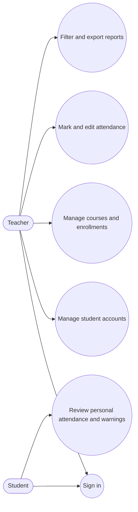
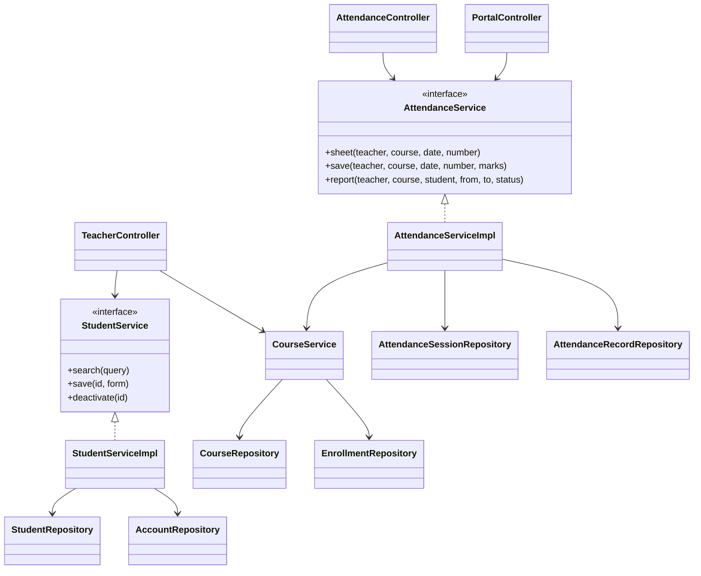

# AttendEase architecture

## Introduction and problem

University teachers need a reliable way to record attendance and identify students at risk of falling below a required threshold. Manual registers and spreadsheets make corrections, percentage calculations, and reports time-consuming. AttendEase stores attendance centrally and calculates course-level percentages from saved class sessions.

## Requirements

Teachers authenticate, maintain the student directory, manage owned courses, enroll students, mark or edit dated sessions, review low attendance, and export filtered records. Students authenticate and view their own course percentages, warnings, and attendance history.

The application uses role-based authorization, CSRF-protected forms, BCrypt password hashes, database constraints, friendly input errors, and responsive pages with labeled forms and keyboard-accessible navigation. MySQL is the persistent store. Spring Boot serves views and handles the application as one deployable unit.

## Use cases

## Class structure

Entities encapsulate their state in private fields. Service interfaces abstract persistence and calculations. Controllers depend on those interfaces and Spring injects the implementations, demonstrating polymorphism. Spring Data repositories extend the standard JPA repository contract. Controllers handle HTTP, services apply rules and manage transactions, and repositories handle persistence. These responsibilities keep controllers and domain services focused.

## Screenshot checklist

Capture screenshots from your own running demo. Include the login page, teacher dashboard with trend and low attendance, student directory and detail page, course enrollment roster, populated attendance sheet after saving, filtered report and CSV output, a student low-attendance warning, and a narrow-screen view with the navigation open. Use demo records for screenshots.

Complete the required two real interviews, interview response analysis, and final personal report using your own work. The [setup guide](../README.md) includes the GitHub publishing workflow.
