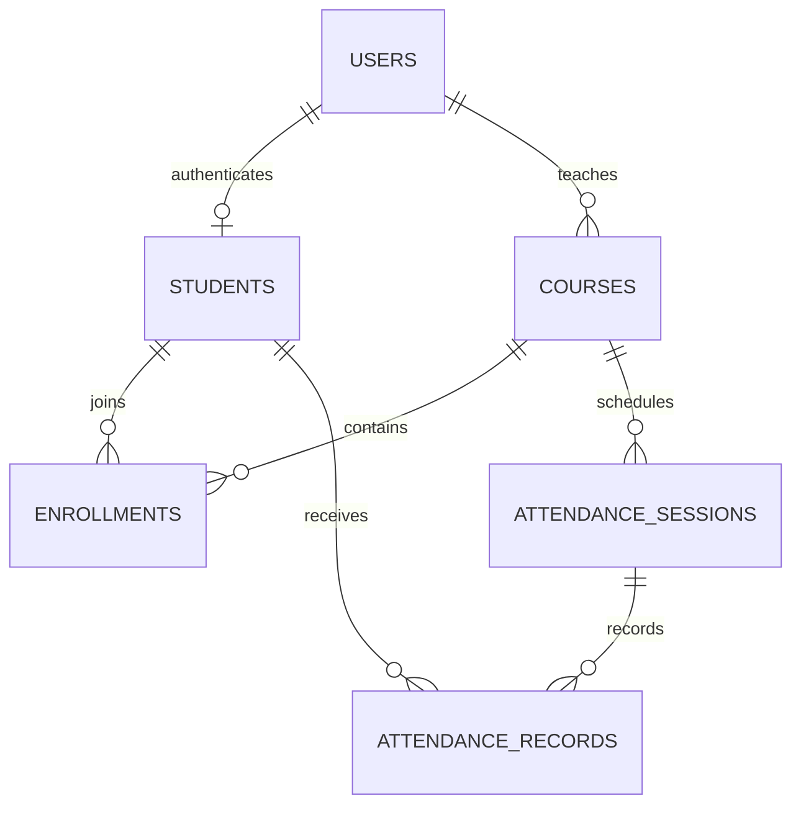

# Database design

Create the database with `database.sql`. Flyway applies `src/main/resources/db/migration/V1__schema.sql` to that database. JPA validates the existing schema at startup.

Unique keys protect usernames, account emails, registration numbers, student emails, and course codes. An enrollment is unique by course and student. A class session is unique by course, date, and session number. A record is unique by session and student. Foreign keys retain referential integrity and support the relationship lookups, with additional indexes for ownership and session date.

Course writes that change enrollment or attendance serialize on the owned course row. Each save uses one transaction and supplies a status for every student on the session roster. Attendance updates change existing records in place. Saved records retain the session roster, and reports check membership in the selected course.
